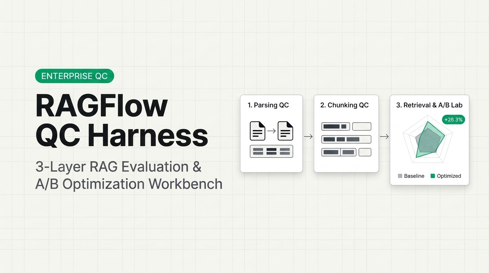
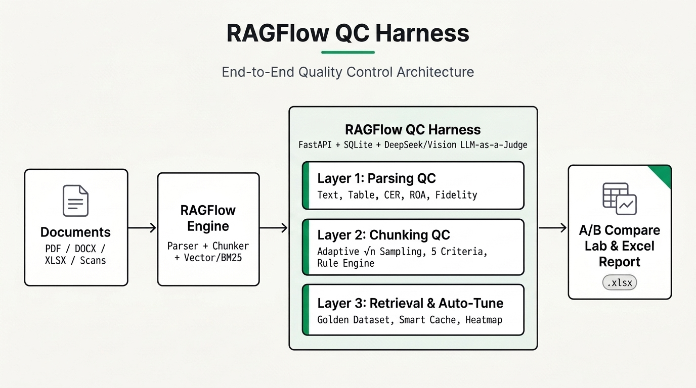
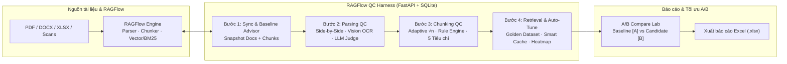

<div align="center">



# RAGFlow QC Harness

**3-Layer Enterprise RAG Quality Control, Auto-Tuning & A/B Evaluation Workbench for RAGFlow**

[](https://www.python.org/)
[](https://fastapi.tiangolo.com/)
[](https://react.dev/)
[](https://www.typescriptlang.org/)
[](https://vitejs.dev/)
[](https://www.sqlite.org/)

[Kiến trúc](#-kiến-trúc-hệ-thống) · [Luồng QC 3 Tầng](#-luồng-đánh-giá-3-tầng) · [Cài đặt & Chạy Local](#-cài-đặt--chạy-local) · [Cấu hình](#-cấu-hình-hệ-thống) · [Deploy AWS](#-deploy-lên-aws-ec2)

</div>

---

## Tổng quan

**RAGFlow QC Harness** là nền tảng kiểm thử và tối ưu hóa chất lượng hệ thống RAG xây dựng chuyên biệt cho **RAGFlow**. Thay vì đánh giá cảm tính ở đầu ra cuối cùng, hệ thống tách nhỏ và đo lường định lượng toàn bộ pipeline qua **3 tầng độc lập** — **Parsing → Chunking → Retrieval** — kết hợp **Rule Engine định lượng**, **Vision OCR**, và **LLM-as-a-Judge**, giúp đội ngũ QC và AI Engineer:

- Truy vết chính xác lỗi bắt nguồn từ tầng nào (đọc file hỏng, cắt đoạn cụt, hay cấu hình tìm kiếm chưa tối ưu).
- Chạy **Auto-Tune Heatmap** tìm bộ tham số Retrieval tối ưu (`vector_similarity_weight`, `similarity_threshold`, `top_k`, `rerank`).
- So sánh trực quan **A/B (Baseline vs Candidate)** trên cùng một bộ tài liệu & Golden Dataset, đo delta từng tầng và từng câu hỏi (`Cứu`, `Tăng điểm`, `Tụt hạng`).
- Chạy **Demo Mode** hoàn toàn tách biệt (`__demo__`) phục vụ trình diễn mà không ảnh hưởng đến dữ liệu thật.

---

## Kiến trúc hệ thống

<p align="center">
  
</p>



---

## Luồng đánh giá 3 tầng

### 1. Bước 1 — Dataset & Đồng bộ RAGFlow
- **Baseline Advisor**: Quét cấu trúc tài liệu gốc (số trang, mật độ bảng biểu, token phân vị P50/P75) để đề xuất cấu hình parser & `chunk_token_num` khởi điểm.
- **Sync Snapshot**: Đồng bộ toàn bộ tài liệu và chunks từ RAGFlow về SQLite local, tự động gắn cờ bất thường (`EMPTY`, `NUMERIC_ONLY_NOISE`, `CHAR_CORRUPTION`).
- **Môi trường Demo độc lập**: Bật **Demo Mode** trong Cài đặt sẽ chuyển sang không gian `__demo__` tách biệt hoàn toàn với các dataset thật.

### 2. Bước 2 — Parsing QC (Chất lượng đọc tài liệu)
- Tự động tách các đoạn đối chiếu ground-truth từ file gốc (`PDF`, `DOCX`, `XLSX`, `MD`, `TXT`, ảnh scan) và căn lề xuyên biên giới chunk (*cross-chunk stitching*).
- Hỗ trợ **Vision OCR** (RapidOCR local miễn phí hoặc Vision LLM) cho trang scan/hình ảnh.
- Chấm điểm bằng **LLM-as-a-Judge** kết hợp đối chiếu **Side-by-Side** (render trực tiếp trang PDF gốc).

| Metric | Ý nghĩa | Mã lỗi liên quan |
|---|---|---|
| **Text Completeness** | Tỷ lệ bảo toàn nội dung chữ so với bản gốc | `P1` (Thiếu nội dung) |
| **Table Accuracy** | Độ chính xác cấu trúc bảng, hàng/cột | `P2`, `P7` (Vỡ bảng / lệch ô) |
| **Character Error Rate (CER)** | Tỷ lệ lỗi dấu tiếng Việt, lỗi ký tự OCR | `P4`, `P5`, `P6` |
| **Layout & Struct** | Bảo toàn heading, danh sách, sơ đồ | `P8`, `P9` |
| **Reading Order (ROA)** | Đúng thứ tự đọc, không đảo cột/trộn dòng | `P3` |
| **Content Fidelity** | Không bịa đặt, sai lệch số liệu/ý nghĩa | `P10` |

### 3. Bước 3 — Chunking QC (Chất lượng cắt đoạn)
- **Lấy mẫu phân tầng Adaptive `√n` (Bankier 1988)**: Tự động phân bổ số lượng chunk mẫu tối ưu theo kích thước từng tài liệu, kết hợp chế độ `Fixed` hoặc `Full 100%`.
- **Rule Engine 100% corpus**: Tự động quét toàn bộ kho chunk để phát hiện chunk quá ngắn (`<50` ký tự), quá dài (`>2600` ký tự), nhiễu số trang, trùng lặp liền kề/xa.
- **Chấm 5 tiêu chí bằng LLM**: `Integrity` (Toàn vẹn câu), `Context Sufficiency` (Đủ ngữ cảnh), `No Noise` (Không nhiễu), `No Duplicate` (Không trùng lặp), `Valid Size` (Đúng kích thước chuẩn).

### 4. Bước 4 — Retrieval, Auto-Tune & So sánh A/B
- **Golden Dataset**: Hỗ trợ nhập từ Excel/CSV hoặc tự động sinh câu hỏi kiểm thử đa tầng (`Local`, `Global`, `Multi-hop`) từ tài liệu gốc.
- **Smart Relevancy Cache**: Tự động kế thừa nhãn đánh giá cho các cặp `(testcase, chunk)` đã chấm trước đó, giảm chi phí và thời gian khi chạy A/B nhiều vòng.
- **Auto-Tune Heatmap**: Quét lưới tham số (`vector_similarity_weight` × `similarity_threshold`) tìm vùng cấu hình ổn định nhất.
- **A/B Compare Lab**: Clone cấu hình từ Baseline `[A]` sang Candidate `[B]`, theo dõi tiến trình pipeline trực tiếp, và hiển thị báo cáo đối chiếu toàn luồng 3 tầng kèm xuất Excel `.xlsx`.

---

## Cấu trúc thư mục

```text
ragflow-qc-harness/
├── backend/
│   ├── main.py                  # FastAPI entrypoint & CORS/Router mount
│   ├── database.py              # SQLite schema, migrations & account_key isolation
│   ├── ragflow_client.py        # Async HTTP client cho RAGFlow API
│   ├── llm_client.py            # DeepSeek / OpenAI-compatible LLM & Vision OCR
│   ├── extractor.py             # Trích xuất ground-truth units từ PDF/DOCX/XLSX
│   ├── metrics.py               # Tính toán metric 3 tầng & cross-chunk alignment
│   ├── baseline_profiler.py     # Phân tích cấu trúc tài liệu cho Baseline Advisor
│   ├── demo_cloner.py           # Engine clone/chấm nhanh cho Demo Mode
│   ├── exporter.py              # Xuất báo cáo Excel (.xlsx)
│   └── routers/                 # workspace, parsing, chunking, retrieval, pipeline, analytics, settings
├── frontend/
│   └── src/
│       ├── api/client.ts        # Typed API client + TTL cache
│       ├── pages/               # Workspace, Parsing, Chunking, Retrieval, ExperimentStudio, Guide
│       └── components/          # Side-by-Side, Heatmap, CloneWorkbench, ChunkExplorer, Modals
├── docs/
│   ├── images/                  # Hero banner & architecture visuals
│   └── diagrams/                # Flow diagrams
└── start_dev.ps1                # Script khởi chạy nhanh Backend + Frontend trên Windows
```

---

## Công nghệ sử dụng

| Thành phần | Stack |
|---|---|
| **Backend** | Python 3.11+, FastAPI, Uvicorn, SQLite, `httpx`, `PyMuPDF (fitz)`, `python-docx`, `openpyxl`, `rapidfuzz`, `rapidocr-onnxruntime` |
| **Frontend** | React 18, TypeScript, Vite 5, Tailwind CSS, Lucide Icons |
| **AI / Judge** | DeepSeek / OpenAI-compatible Chat API, Vision LLM / Local RapidOCR |
| **Target RAG** | RAGFlow (Docker / Self-hosted API) |

---

## Cài đặt & Chạy Local

### Yêu cầu tiên quyết
- **Python 3.11+**
- **Node.js 18+** & `npm`
- **RAGFlow** đang chạy (ví dụ `http://localhost` / port `9380`) hoặc sử dụng **Demo Mode**

### Cách 1 — Khởi chạy nhanh trên Windows
```powershell
.\start_dev.ps1
```

### Cách 2 — Chạy thủ công từng tiến trình

**1. Backend (port `8000`)**
```bash
cd backend
pip install -r requirements.txt
python -m uvicorn main:app --host 127.0.0.1 --port 8000
```

**2. Frontend (port `5173`)**
```bash
cd frontend
npm install
npm run dev
```

Mở trình duyệt tại **`http://localhost:5173`**.

---

## Cấu hình hệ thống

Vào mục **Cài đặt** (góc trên bên phải giao diện) để cấu hình:

1. **RAGFlow API**:
   - `RAGFlow Base URL`: ví dụ `http://localhost` (hoặc domain/IP server RAGFlow)
   - `RAGFlow API Key`: lấy từ trang cài đặt tài khoản RAGFlow
2. **LLM-as-a-Judge**:
   - `Base URL`: hỗ trợ mọi endpoint chuẩn OpenAI (ví dụ `https://api.deepseek.com/v1`)
   - `Model`: ví dụ `deepseek-chat`, `gpt-4o-mini`
   - `API Key`: khóa API tương ứng
3. **Vision OCR (tùy chọn)**: mặc định dùng `local-rapidocr` miễn phí, hoặc cấu hình Vision LLM (`gemini-2.0-flash`, `gpt-4o-mini`, `qwen2.5-vl`).
4. **Demo Mode**: bật để chuyển sang môi trường demo song song (`__demo__`), không ảnh hưởng dữ liệu thật.

---

## Deploy lên AWS EC2

Vì hệ thống lưu snapshot vào SQLite local (`backend/data/ragflow_qc.db`) và file gốc trong `backend/data/uploads/`, kiến trúc gọn và ổn định nhất trên AWS là **1 EC2 instance** (`t3.medium`, Ubuntu 22.04/24.04, 30GB EBS):

1. **Build Frontend tĩnh**:
   ```bash
   cd frontend && npm ci && npm run build
   ```
2. **Chạy Backend với 1 worker** (đảm bảo an toàn ghi SQLite):
   ```bash
   cd backend && python -m uvicorn main:app --host 127.0.0.1 --port 8000 --workers 1
   ```
3. **Cấu hình Nginx Reverse Proxy**:
   - Serve `frontend/dist/` tại `/` (`try_files $uri /index.html;`).
   - Proxy `/api/` về `http://127.0.0.1:8000` với `proxy_read_timeout 600s;` và `client_max_body_size 100M;`.
4. **HTTPS & Backup**:
   - Gắn Elastic IP + Domain, chạy `sudo certbot --nginx -d your-domain.com`.
   - Lập lịch cronjob đồng bộ `backend/data/ragflow_qc.db` lên **Amazon S3** định kỳ.

---

<div align="center">
  <sub>Built for systematic RAG evaluation & optimization on RAGFlow.</sub>
</div>
